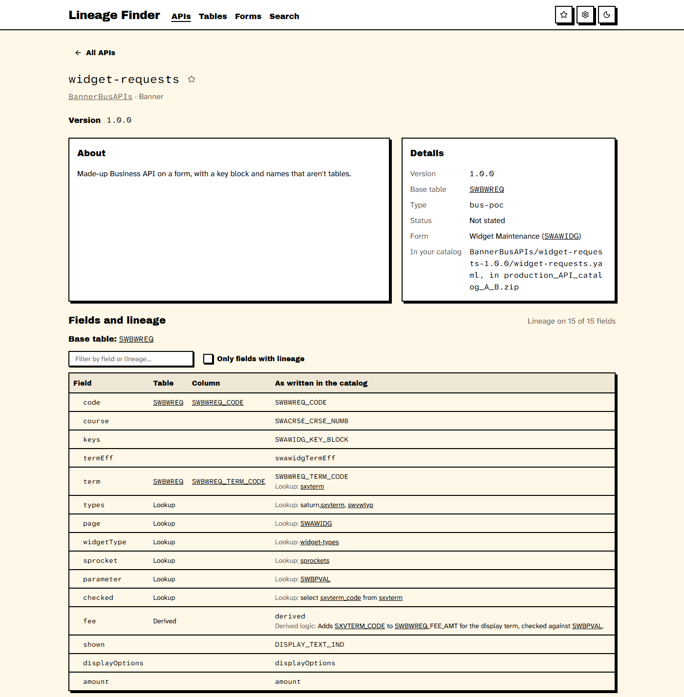

# Lineage Finder

See which database tables and columns sit behind each field of Ellucian's APIs. Lineage Finder reads the API catalog
Ellucian provides to its customers, and lets you browse it, search it and follow the lineage. It runs on your own
computer.

**Unofficial:** not affiliated with or endorsed by Ellucian. Lineage Finder includes no Ellucian material: you use
your own copy of the catalog, under your institution's agreement with Ellucian. Ellucian, Banner and Colleague are
registered trademarks of Ellucian Company LLC.

## What you need

- **Node.js 24 or newer**, from [nodejs.org](https://nodejs.org).
- An **Ellucian customer login**, to download the catalog.

## Get started

1. Download the newest `lineage-finder-<version>.zip` from [Releases](../../releases).
2. Unzip it into a folder of its own.
3. Download the API catalog's five zip files from
   [Ellucian's download page](https://resources.elluciancloud.com/r/bundle/dev_res_ref_api_catalog/page/c_download_view_api_catalog.html)
   (you'll need your Ellucian login). Put them, as they are, into the `catalog-zips` folder. No need to unzip them.
4. Open a terminal in the folder and run `npm start`. Your browser opens Lineage Finder.
5. With "In the app's catalog-zips folder" chosen, press **Read my catalog**. Building the index takes about 40
   seconds.

Ctrl+C in the terminal stops the app.

## When Ellucian publish a new catalog

Delete the old zips from `catalog-zips` and put the new ones in. Lineage Finder notices and offers to re-read them.

## Moving to a new version of Lineage Finder

1. Unzip the new release into a new folder.
2. Move the `data` folder (your index, and where your catalog is) across from the old one, and your zips too if
   they're in its `catalog-zips`.
3. Run `npm start` in the new folder. When you're happy, delete the old one.

Favourites, Recently viewed and the look are kept by your browser, so they carry over.

## Your data

Everything stays on your computer: Lineage Finder only answers your own browser, and sends nothing anywhere. The
index it makes is in the `data` folder. To start again, delete that folder (or use Settings > Delete the index data).

## Problems and ideas

A spare-time project, shared as is, made and tested on Windows only. If something goes wrong,
[open an issue](../../issues/new/choose): say what you did and paste the message you saw. Issues are public, so don't
paste anything from the catalog or about your institution.

## Licence

MIT: see [LICENSE](LICENSE). Lineage Finder includes open-source packages and fonts by others, listed with their
licences in [THIRD-PARTY-NOTICES.txt](THIRD-PARTY-NOTICES.txt).

## For developers

To run from the source code instead of a release: with Node.js 24, `npm ci`, then `npm start` (or `npm run dev`
while editing; `npm run check` for the type checks and tests). The tests use a made-up catalog, in
`indexer/test-catalog/`. Some managed computers block the build tools; use a release there.
